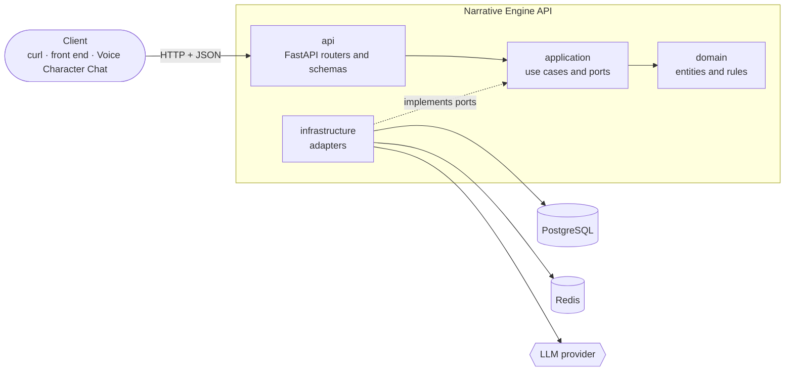

# Narrative Engine API

[](https://github.com/gutembergborges/narrative-engine-api/actions/workflows/ci.yml)
[](LICENSE)

An API that works as a narrative/RPG engine. It keeps character sheets, world state and
inventory in a database, enforces the game rules in code, and asks a language model (LLM)
only for the narration.

> **Status: Milestone 0 (scaffold).** Today the API has one endpoint, `GET /health`, and one
> passing test. Everything else on this page is the plan. See the [roadmap](#roadmap).

## The problem

When a chat model runs a role-playing story by itself, the state lives only in the
conversation. The model forgets what is in the inventory, contradicts the world it described
ten messages ago, and the "rules" are sentences in a prompt that nothing enforces.

This project separates the two jobs:

- **The engine owns the truth.** Characters, world state and inventory are stored in
  PostgreSQL and changed only through tested business rules.
- **The LLM owns the prose.** It receives the current state and returns narration. It can be
  replaced (hosted provider, local model, or a fake in tests) without touching the rules.

## Architecture

A modular monolith in Clean Architecture. One rule: dependencies point inward.



| Layer | Holds | May import |
| --- | --- | --- |
| `domain` | Entities and business rules | Standard library only |
| `application` | Use cases and ports (interfaces) | `domain` |
| `infrastructure` | PostgreSQL, Redis and LLM adapters | `application`, `domain` |
| `api` | HTTP routes, schemas, wiring | `application` (and `infrastructure` for wiring) |

More detail, including why each file exists: [docs/architecture.md](docs/architecture.md).

## Stack

| Concern | Choice |
| --- | --- |
| Language | Python 3.14 |
| Web framework | FastAPI (with Pydantic v2 and Uvicorn) |
| Database | PostgreSQL 18 |
| Cache | Redis 8 |
| Local services | Docker Compose |
| Dependencies | uv |
| Lint and format | Ruff |
| Tests | Pytest |
| CI | GitHub Actions |

The reasons and the exact versions are in [ADR 0001](docs/adr/0001-stack.md).

## How to run

You need [Docker](https://docs.docker.com/get-started/get-docker/) (with Compose v2) and
[uv](https://docs.astral.sh/uv/getting-started/installation/). uv installs Python 3.14 for
you if it is missing.

```bash
# 1. Get the code
git clone https://github.com/gutembergborges/narrative-engine-api.git
cd narrative-engine-api

# 2. Create your local environment file (never committed)
cp .env.example .env

# 3. Start PostgreSQL and Redis in the background
docker compose up -d
docker compose ps          # both services should show "healthy"

# 4. Install the project and its dev tools into .venv
uv sync

# 5. Run the tests
uv run pytest              # expected: 1 passed

# 6. Start the API with auto-reload
uv run fastapi dev src/narrative_engine/api/main.py
```

Then open:

- <http://127.0.0.1:8000/health> returns `{"status": "ok"}`
- <http://127.0.0.1:8000/docs> shows the interactive OpenAPI documentation

Useful commands:

| Command | What it does |
| --- | --- |
| `uv run ruff check .` | Lint |
| `uv run ruff format .` | Format |
| `docker compose logs -f postgres` | Follow the database logs |
| `docker compose down` | Stop the services, keep the data |
| `docker compose down -v` | Stop the services and delete the data |

## Roadmap

| Milestone | Outcome | Status |
| --- | --- | --- |
| M0 · Bootstrap | Repository, CI, Docker Compose, `/health` with a green test | In review |
| M1 · First narrative endpoint | One request returns generated narrative text, test-first, LLM behind a port | Next |
| M2 · Domain core | Character sheets, world state and inventory with unit-tested rules | Planned |
| M3 · Documentation and quality | Reviewed OpenAPI docs, type checking, AI review on pull requests | Planned |
| M4 · Agents for the lifecycle | `CLAUDE.md`, Skills, MCP servers and subagents, added one phase at a time | Planned |
| M5 · Front end and Game Master | A browser client and one playable narrated session | Planned |

Work is tracked in [GitHub Issues](https://github.com/gutembergborges/narrative-engine-api/issues),
grouped by milestone.

## Documentation

| Document | What it answers |
| --- | --- |
| [docs/architecture.md](docs/architecture.md) | How is the code organized, and why does each file exist? |
| [docs/adr/0001-stack.md](docs/adr/0001-stack.md) | Why this stack, and which versions? |
| [docs/LEARNING_PATH.md](docs/LEARNING_PATH.md) | What do I learn at each milestone, and where are the official docs? |
| [docs/AGENTIC_ROADMAP.md](docs/AGENTIC_ROADMAP.md) | When and how do AI agents enter this project? |
| [docs/CLAUDE_MD_EXPLAINED.md](docs/CLAUDE_MD_EXPLAINED.md) | What does each line of `CLAUDE.md` do? |
| [CONTRIBUTING.md](CONTRIBUTING.md) | Branches, commits and pull requests |

## How this repository is built

The feature code (domain, use cases, endpoints and their tests) is written by hand, so that
every line can be explained. AI assistance was used for the initial scaffold and is added to
the workflow in deliberate phases, described in
[docs/AGENTIC_ROADMAP.md](docs/AGENTIC_ROADMAP.md).

## License

[MIT](LICENSE)
