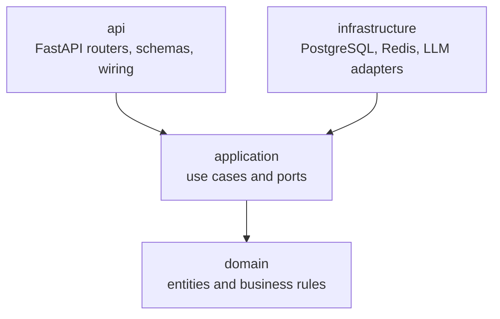
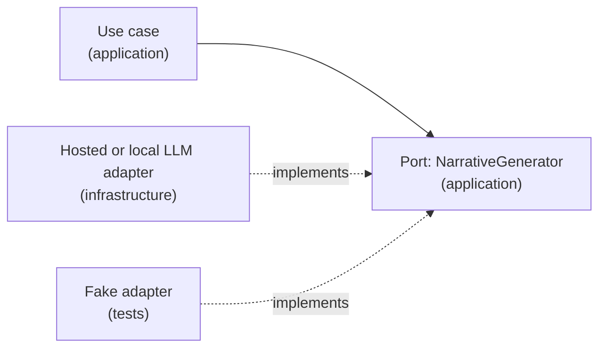
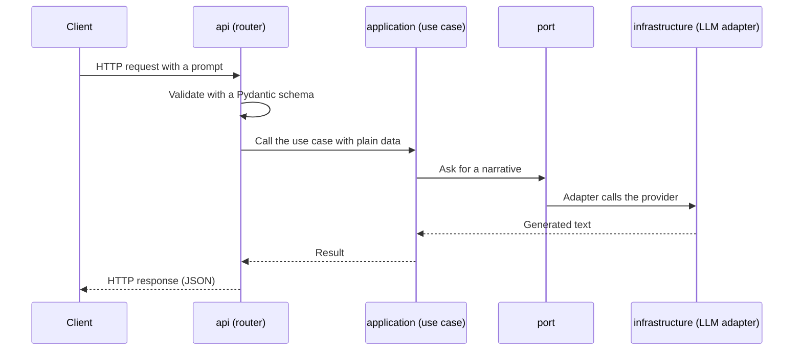

# Architecture

This document explains how the code is organized and why each file exists. The decision
behind it is recorded in [ADR 0001](adr/0001-stack.md).

## The one rule

**Dependencies point inward.** Code in an inner layer never imports from an outer layer.

| Layer | Question it answers | May import | Laravel analogy |
| --- | --- | --- | --- |
| `domain` | What is always true about the game? | Standard library only | Plain PHP classes with rules, no Eloquent |
| `application` | What can the system do? | `domain` | Action / service classes plus interfaces |
| `infrastructure` | How do we talk to the outside world? | `application`, `domain` | Repository implementations, API clients |
| `api` | How does HTTP map to use cases? | `application`; `infrastructure` only for wiring | Routes, controllers, form requests, service provider bindings |

Why bother: the rules of the game can be tested in milliseconds without a database, and the
database, the web framework or the LLM provider can change without rewriting those rules.

## Ports and adapters

A **port** is an interface that a use case needs. In Python it is a `typing.Protocol`. It is
defined in `application`, next to the use case that needs it.

An **adapter** is a class in `infrastructure` that implements a port using a real technology.

The use case knows only the port. Which adapter it receives is decided in one place, the
composition root in `api`, using FastAPI's dependency injection. In Laravel terms: binding an
interface to an implementation in a service provider.

## Planned request flow (Milestone 1)

Nothing below exists yet. It is the target shape for the first narrative endpoint.

## Testing strategy

| Kind | Tests | Needs | Folder |
| --- | --- | --- | --- |
| Unit | Domain rules and use cases, with fake adapters | Nothing | `tests/unit/` (created with the first unit test) |
| Integration | Adapters against real PostgreSQL / Redis | Docker Compose services | `tests/integration/` (Milestone 2) |
| API | HTTP in, HTTP out, through `TestClient` | Nothing for now | `tests/api/` |

Tests never call a real LLM provider: it costs money and makes CI unreliable.

## File map: why each file exists

### Root

| File | Why it exists |
| --- | --- |
| `README.md` | The front door: problem, architecture, how to run, roadmap. |
| `LICENSE` | MIT. Without a license, nobody may legally reuse public code. |
| `pyproject.toml` | The project's single config file: metadata, dependencies, Ruff and Pytest settings. Like `composer.json`. |
| `.python-version` | Tells uv which Python to install and use, so everyone (and CI) runs the same one. |
| `.gitignore` | Keeps secrets, virtual environments and caches out of Git. |
| `.env.example` | Documents every environment variable with safe placeholder values. The real `.env` is never committed. |
| `docker-compose.yml` | Starts PostgreSQL and Redis locally with one command. |
| `CONTRIBUTING.md` | The workflow: branches, Conventional Commits, pull requests. |
| `CLAUDE.md` | Standing instructions for Claude Code in this repository. See [CLAUDE_MD_EXPLAINED.md](CLAUDE_MD_EXPLAINED.md). |
| `uv.lock` | Not in the scaffold. Created by your first `uv sync` and then committed: exact versions of every dependency, like `composer.lock`. |

### `.github/`

| File | Why it exists |
| --- | --- |
| `workflows/ci.yml` | Runs lint, format check and tests on every pull request and on pushes to `main`. |
| `pull_request_template.md` | Pre-fills each pull request with what, why, how to test and a checklist. |

### `src/narrative_engine/`

The `src/` layout forces tests to import the installed package, the same way a user would,
instead of whatever happens to be in the current folder.

| File | Why it exists |
| --- | --- |
| `__init__.py` | Marks the folder as the `narrative_engine` package and states the layer rule. |
| `domain/__init__.py` | Reserves the domain layer and documents its rule. Empty until Milestone 2. |
| `application/__init__.py` | Reserves the application layer and documents its rule. Empty until Milestone 1. |
| `infrastructure/__init__.py` | Reserves the infrastructure layer and documents its rule. Empty until Milestone 1. |
| `api/__init__.py` | Marks the API layer and documents its rule. |
| `api/main.py` | Creates the FastAPI app and the `/health` endpoint. The entry point the server runs. |

### `tests/`

| File | Why it exists |
| --- | --- |
| `api/test_health.py` | One passing test, so the first run shows a green PASS and CI has something to verify. |

### `docs/`

| File | Why it exists |
| --- | --- |
| `architecture.md` | This file. |
| `adr/0001-stack.md` | Why this stack and architecture, which versions, what was rejected. |
| `LEARNING_PATH.md` | What each milestone teaches, with official documentation links. |
| `AGENTIC_ROADMAP.md` | The phases in which AI agents enter the project. |
| `CLAUDE_MD_EXPLAINED.md` | Line-by-line explanation of `CLAUDE.md`. |

## Rebuild it yourself

A good check that the scaffold is understood: recreate it in an empty folder without copying.

1. `uv init --package` and compare the generated `pyproject.toml` with this one.
2. `uv add "fastapi[standard]"` and `uv add --dev pytest httpx ruff`.
3. Write `main.py` with `/health` and its test from memory.
4. Write `docker-compose.yml` with one service, start it, then add the second.
5. Write the CI workflow and make it green on a throwaway repository.

If a step needs the original file open, that step is the one to study next.
